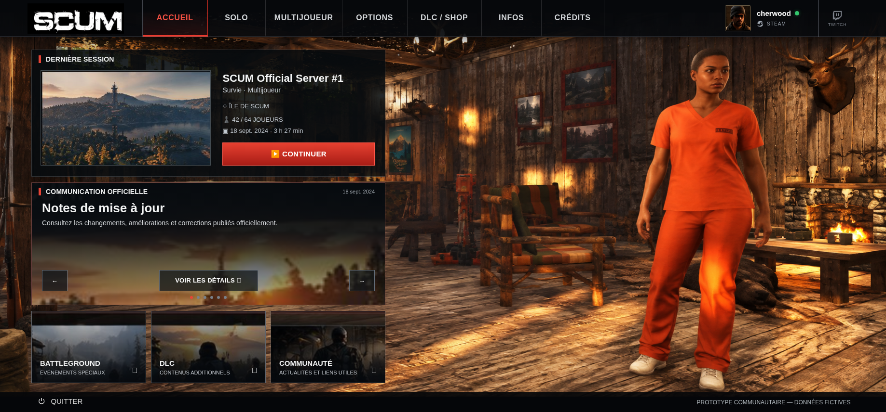

# Accueil — fond authentique SCUM

Base de l’interface : géométrie validée de la PR #2, commit `f0941d4`.
Source récupérée sur `main`, commit `62dda55` :
[SCUM_Lobby_Original.png.png](../../references/SCUM_Lobby_Original.png.png).
Le fichier ajouté porte une double extension ; son nom et ses octets sont
conservés. La maquette complète n’est pas utilisée comme fond.

## Comparaison à 1837 × 856

| Avant | Après |
| --- | --- |
| [Fond précédent](before-1837x856.png) | [Capture authentique](after-1837x856.png) |

### Avant

### Après

Vérifications complémentaires : [1366 × 768](after-1366x768.png) et
[390 × 844, page entière](after-390x844.png).

## Modification appliquée

Seul le pseudo-élément `.app[data-bg="home"]::before` change. Il référence
le PNG authentique de 1836 × 856, qui contient le chalet sur toute sa largeur.
La grande zone noire du fond précédent n’est donc plus affichée.

Sur ordinateur, le fond est dimensionné à la largeur de la fenêtre et à la
hauteur de sa propre surface, indépendamment de la grille des panneaux. À
1837 × 856, cette surface va de y = 26 à y = 824 : les portions sous la
navigation et le pied de page sont masquées par ces barres. Le redimensionnement
CSS réduit légèrement la hauteur de la capture pour garder la tête et les
chaussures visibles, à proximité du cadrage de la maquette. Le PNG n’est ni
recadré, ni retouché, ni réencodé. La perspective, la pose et l’éclairage de la
capture fournie diffèrent de la maquette ; ils restent ceux de cette source.

Sur mobile, le fond conserve ses proportions avec `cover` et un ancrage à
droite. Aucun panneau ni contrôle ne change de taille ou de position.

Les transparences des panneaux et le léger dégradé du fond préexistant sont
conservés. Les six communications, leurs six indicateurs et tous les
gestionnaires d’interaction restent inchangés. Typographie, pictogrammes,
couleurs de l’interface et illustrations secondaires ne sont pas modifiés.

## Ancien menu SCUM

Inspection visuelle de la source complète et de la capture rendue : aucun
libellé de l’ancien menu SCUM n’est visible dans le fichier fourni ou à travers
les panneaux. Aucune correction localisée n’a été appliquée. Les éléments
présents dans le décor, notamment les affiches, sont conservés.

## Contrôles

**20 tests passent** sous Chromium avec
`PLAYWRIGHT_CHROMIUM_EXECUTABLE_PATH=/usr/bin/chromium npm test`.
`npm run format:check` passe également.

- Empreinte du PNG fourni :
  `915c0e5de53613473fc948f7f13c4f9d4919b5a45ba1e4e8e8ce47b02fa388f4`.
- L’export autonome contient exactement les octets de ce PNG, intégrés en
  Base64, ainsi que les 22 images originales de V0.4.3 toujours préservées.
- Une empreinte des règles CSS hors fond vérifie leur identité avec la géométrie
  validée de PR #2, sur ordinateur comme sur mobile.
- Les tests existants continuent de vérifier les six communications, les
  interactions, les limites des panneaux et le rendu des autres rubriques.
- Vérifications en développement et dans l’HTML autonome hors ligne.

## Organisation de la PR

La PR #2 est fusionnée dans `main` au commit `067dd55`. Cette PR cible désormais
`main` et présente uniquement le changement de fond, ses tests et sa
documentation ; la géométrie validée ne figure plus dans son diff.
La branche de travail intègre cette version de `main`. Aucune fusion de la
PR #3 dans `main` n’est effectuée.

Validation visuelle obtenue pour le fond ; les finitions suivantes restent
une intervention distincte.
