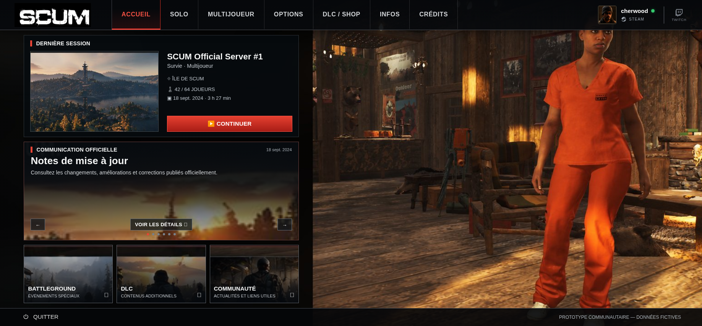
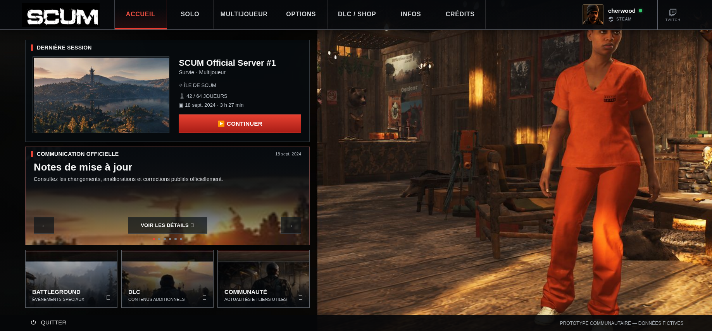

# Accueil — première correction de géométrie

Référence : [Lobby_Accueil_v1.png](../../references/Lobby_Accueil_v1.png),
1837 × 856. Base de travail : `main`, commit `2e7433a`.

La correction porte uniquement sur les dimensions, grilles, marges et espacements
appliqués à `.app[data-bg="home"]`. Aucun template, gestionnaire d'événement,
contenu, pictogramme, couleur, police ou fichier image n'est modifié. Les six
communications et leurs six indicateurs sont conservés.

## Captures avant / après

Les deux captures de bureau correspondent exactement aux dimensions indiquées.
Les captures mobiles montrent la page entière pour rendre visibles les trois
sections et le pied de page ; le viewport utilisé est bien 390 × 844.

| Viewport | Avant | Après |
| --- | --- | --- |
| 1837 × 856 | [Avant](before-1837x856.png) | [Après](after-1837x856.png) |
| 1366 × 768 | [Avant](before-1366x768.png) | [Après](after-1366x768.png) |
| 390 × 844 | [Avant, page entière](before-390x844.png) | [Après, page entière](after-390x844.png) |

### Avant — 1837 × 856

### Après — 1837 × 856

## Géométrie à 1837 × 856

Mesures arrondies. La tolérance de comparaison aux limites relevées sur la
maquette est de 2 px, compte tenu des grilles fractionnaires et de la lecture
sur une image raster.

| Élément | Avant | Après |
| --- | --- | --- |
| Hauteur de navigation | 79 px | 77 px |
| Pied de page | y = 809, hauteur 47 px | y = 814, hauteur 42 px |
| Colonne gauche | x = 62, y = 92, largeur 719 px | x = 65, y = 103, largeur 734 px |
| Dernière session | hauteur 268 px | hauteur 264 px |
| Illustration de session | x = 79, y = 134, 336 × 212 px | x = 84, y = 146, 353 × 198 px |
| Bouton Continuer | x = 437, y = 304, 327 × 42 px | x = 461, y = 296, 316 × 48 px |
| Communication | y = 372, hauteur 258 px | y = 379, hauteur 254 px |
| Contrôles du carrousel | y = 574, hauteur 31 px | y = 561, hauteur 44 px |
| Cartes inférieures | y = 643, hauteur 153 px | y = 646, hauteur 150 px |

Les sections utilisent CSS Grid et des proportions de lignes/colonnes ; aucune
coordonnée absolue de positionnement n'a été ajoutée. Le bouton Continuer reste
ancré en bas de sa colonne flex et aligné au bas de l'illustration.

À 1366 × 768, la colonne et les lignes se réduisent avec l'espace disponible,
sans débordement horizontal ni contenu coupé dans les détails de session.
À 390 × 844, la navigation occupe une seconde ligne sous le logo et le profil,
les panneaux occupent la largeur disponible et le pied de page suit le contenu.
La page défile verticalement ; le menu défile horizontalement.

## Vérifications

La suite finale de **18 tests passe** sous Chromium, avec
`PLAYWRIGHT_CHROMIUM_EXECUTABLE_PATH=/usr/bin/chromium npm test`.
Le contrôle de formatage `npm run format:check` passe également.

- Géométrie mesurée à la résolution de référence et absence de chevauchement
  ou débordement aux trois viewports demandés, sur Vite et dans l'export autonome.
- Propriétés typographiques et couleurs calculées comparées à V0.4.3.
- Parcours de l'Accueil, boucle sur les six communications, dialogues et retour
  des Crédits, par vrais clics, y compris sur mobile.
- Autres rubriques comparées pixel par pixel à V0.4.3, comme avant cette étape.
- Intégrité des 22 ressources originales et HTML autonome utilisable hors ligne.

La comparaison visuelle de l'Accueil à V0.4.3 est remplacée par des assertions de
mesures de la nouvelle géométrie et de conservation des styles. Les assertions
comportementales de la suite historique restent actives. La maquette complète
n'est pas une cible de comparaison pixel par pixel dans cette étape, puisque les
ressources et finitions n'ont pas encore été corrigées.

## Ressources insuffisantes pour l'étape graphique suivante

Ces fichiers sont inchangés :

- `assets/images/home-background.jpg` : 1837 × 715, avec une zone noire intégrée
  à gauche. Le chalet et le personnage sont authentiques, mais cette source ne
  contient pas le décor visible à gauche de la maquette. Son cadrage `cover`
  reste inchangé pendant l'intervention géométrique.
- `assets/images/home-news.jpg` : 670 × 63, résolution insuffisante pour la
  surface affichée. L'agrandissement et le flou restent visibles.
- `assets/images/promo-battleground.jpg` : 230 × 85 ;
  `promo-dlc.jpg` : 228 × 85 ; `promo-community.jpg` : 229 × 85.
  Ces illustrations sont petites et contiennent une bande sombre supérieure.

Les sources originales de meilleure qualité seront nécessaires pour corriger
ces écarts fidèlement. Aucune illustration n'est générée et aucune maquette
complète n'est utilisée comme fond. Typographie, couleurs, avatar et glyphes
restent ceux de V0.4.3 et relèvent d'une intervention ultérieure.
