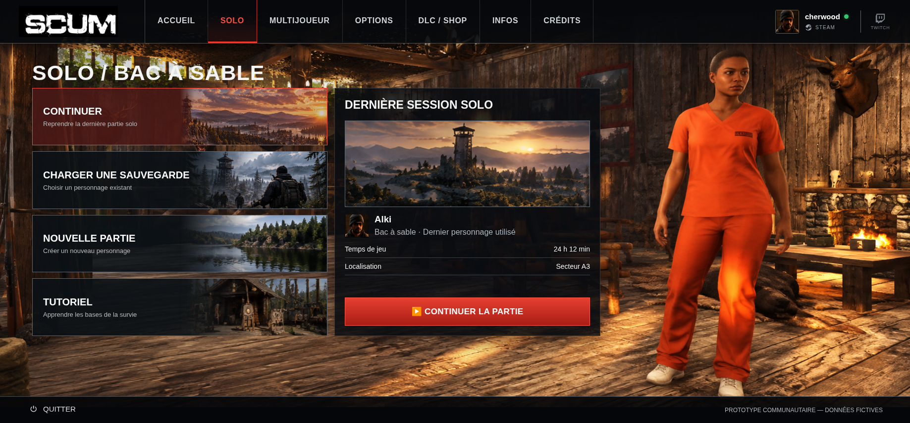

# SOLO — simulation des illustrations, à valider

Branche `review/solo-illustrations-v1`, issue de `main` au commit `f97ab29`.
Cette revue ne modifie ni le prototype, ni ses imports, ni ses ressources de
production, ni la release v0.5.0. Aucune PR d'intégration n'est créée.

## Captures

| Résolution | État avant | Simulation |
| --- | --- | --- |
| 1837 × 856 | [Avant](avant-1837x856.png) | [SOLO complet](solo-simulation-1837x856.png) |
| 1366 × 768 | [Avant](avant-1366x768.png) | [Aperçu](solo-simulation-1366x768.png) |
| 390 × 844 | [Avant](avant-390x844.png) | [Haut de page](solo-simulation-390x844.png), [Dernière session après défilement](solo-detail-390x844.png) |

[Cartes à leur taille d'affichage desktop](cartes-1837.png) ·
[Panneau Dernière session desktop](derniere-session-1837.png).



## Ressources et cadrages

| Élément | Source | Dimensions natives | Traitement de revue |
| --- | --- | --- | --- |
| Chalet et personnage | `docs/references/SCUM_Lobby_Original.png.png` | 1836 × 856 | Référence directe au fichier existant, même peinture de fond que l'Accueil ; aucun fichier dupliqué. |
| CONTINUER | `assets/images/home-communication-officielle.png` | 2129 × 405 | `cover` dans la moitié droite, position horizontale 46 %, fondu vers la gauche et teinte rouge liée à `.active`. |
| CHARGER UNE SAUVEGARDE | `assets/images/home-battleground.png` | 694 × 320 | `cover` centré dans la moitié droite, forêt et survivants conservés. |
| NOUVELLE PARTIE | [nouvelle-partie.png](nouvelle-partie.png) | 264 × 118 | Découpe native du lac et de la forêt ; `cover` centré, sans étirement. |
| TUTORIEL | [tutoriel.png](tutoriel.png) | 264 × 121 | Découpe native de la cabane ; `cover` centré, sans étirement. |
| Dernière session SOLO | [derniere-session.png](derniere-session.png) | 444 × 159 | Découpe native du panorama propre ; `cover` dans l'emplacement existant. |
| Portrait Alki | `assets/images/avatar.png` | 65 × 64 | Affichage avec `contain` dans 48 × 48 px, 32 × 32 px sur mobile ; aucun agrandissement. |

Les trois découpes proviennent exclusivement de
`docs/references/Lobby_Solo_Illustrations_Proposition_v1.png` (1836 × 856).
Les coordonnées exactes et empreintes SHA-256 sont enregistrées dans
[crops.json](crops.json). Aucun pixel de texte, séparateur, bordure ou bouton de
la proposition n'est inclus. Les PNG gardent leurs pixels d'origine : aucune
génération, retouche, correction colorimétrique ou interpolation enregistrée.

Le fondu et la sélection sont appliqués en CSS : les PNG ne portent pas de
teinte rouge. L'image occupe uniquement la moitié droite des cartes, derrière
leur contenu, sans intercepter les clics. Le portrait utilise la zone existante
du nom et du descriptif ; les boîtes et les hauteurs restent identiques.

## Limites à valider visuellement

- Les découpes du lac et de la cabane sont de petite définition. À 1837 px,
  leur largeur passe de 264 à environ 297 px, soit un agrandissement de 12,5 %.
  Une légère douceur est visible ; un original propre en meilleure définition
  serait préférable pour une finition plus nette. Aucun autre fichier du dépôt
  ne fournit ces mêmes scènes en meilleure qualité. Éviter un agrandissement
  artificiel comme substitut à une véritable source.
- La bannière passe de 444 à environ 493 px de large sur grand écran, soit
  environ 11 % d'agrandissement. Elle reste exploitable en revue. Si la netteté
  est insuffisante, le panorama propre `home-communication-officielle.png`
  constitue une alternative existante de meilleure définition, avec une autre
  tour et une autre composition ; elle n'est pas substituée sans validation.
- À 390 px, CONTINUER privilégie la tour (position 32 %). Le disque solaire est
  hors cadre ; le ciel du coucher de soleil reste visible. Afficher toute cette
  image de ratio 5,26 dans une demi-carte de ratio 2,12 demanderait soit des
  marges, soit une autre composition. Aucune déformation n'est appliquée.
- Le toit de la cabane est déjà coupé en haut dans la proposition. La découpe
  n'invente pas la partie absente. La porte et les cibles restent visibles.
- Seule la bannière du panneau **Dernière session** est simulée. Les illustrations
  internes des panneaux Sauvegardes, Nouvelle partie et Tutoriel restent celles
  du prototype ; leur remplacement ne fait pas partie de cette revue.
- Les pictogrammes existants sont conservés, notamment le triangle Unicode du
  bouton SOLO, dont le rendu dépend du système.

## Vérifications effectuées

Le script [capture.mjs](capture.mjs) charge l'application Vite actuelle puis
injecte uniquement [simulation.css](simulation.css) dans le navigateur. Il ne
réécrit aucun fichier de production.

Résultats détaillés dans [verification.json](verification.json) :

- Trois résolutions, quatre états SOLO : dimensions et positions des panneaux,
  cartes, navigation, profil, pied de page et enfants du panneau identiques avant
  et après injection ; textes identiques et absence de débordement horizontal.
- Clics réels sur les quatre parcours, leurs boutons et confirmations simulées.
  Sélection d'une sauvegarde, annulation et simulation de suppression vérifiées.
- Toutes les images chargées, aucune erreur JavaScript détectée.
- Accueil identique pixel par pixel avant et après chargement de la CSS de revue
  aux trois résolutions. Les sélecteurs de la simulation ciblent uniquement SOLO.
- Aucun changement de code, de ressources ou de références hors de ce dossier.

La suite de production et la compilation ne sont pas relancées : cette simulation
n'entre pas dans l'application ou son export. Aucun nouvel export de release
n'est produit ni modifié.

## Reproduire la revue

Depuis la racine du dépôt, avec les dépendances déjà installées :

```sh
npm run dev -- --port 5173 --strictPort
```

Dans un autre terminal, avec Python/Pillow et Chromium disponibles :

```sh
python3 docs/reviews/solo-illustrations/prepare.py
node docs/reviews/solo-illustrations/capture.mjs
```

Le script utilise `/usr/bin/chromium` par défaut. Les variables
`PLAYWRIGHT_CHROMIUM_EXECUTABLE_PATH` et `SCUM_REVIEW_URL` permettent de choisir
un autre exécutable et une autre URL de développement. La CSS de revue n'est
pas activée lors d'un lancement normal de l'application.
