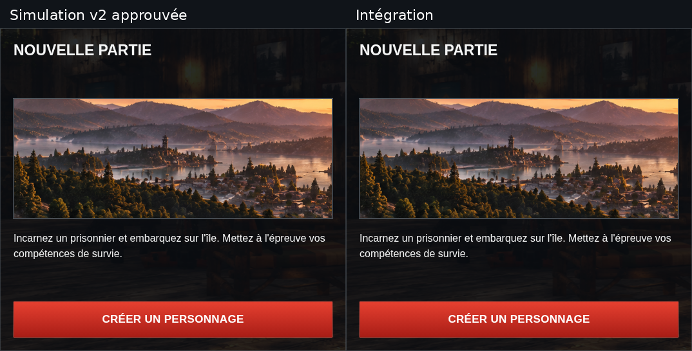

# SOLO — intégration de NOUVELLE PARTIE v2

Branche `feat/solo-new-game-composition`, créée depuis `main` (`e737ead`, PR #9
et #10 intégrées). Référence : `review/solo-new-game-v2`, commit `59bd045`.
Le dossier [de revue v2](../solo-new-game-v2/README.md) est conservé intégralement,
sans modification de ses fichiers.

## Captures finales

| Résolution | Intégration Vite | Simulation approuvée | Export hors ligne |
| --- | --- | --- | --- |
| 1837 × 856 | [Panneau complet](development-1837x856.png) | [Référence](../solo-new-game-v2/nouvelle-partie-1837x856.png) | [Capture](offline-1837x856.png) |
| 1366 × 768 | [Panneau complet](development-1366x768.png) | [Référence](../solo-new-game-v2/nouvelle-partie-1366x768.png) | [Capture](offline-1366x768.png) |
| 390 × 844 | [Vue initiale](development-390x844.png) | [Référence](../solo-new-game-v2/nouvelle-partie-390x844.png) | [Capture](offline-390x844.png) |
| 390 × 844 après défilement | [Panneau complet](development-detail-390x844.png) | [Référence](../solo-new-game-v2/nouvelle-partie-detail-390x844.png) | [Capture](offline-detail-390x844.png) |

Les quatre cadrages Vite et hors ligne sont **identiques octet pour octet** aux
PNG approuvés. Les empreintes figurent dans [verification.json](verification.json).



Le comparatif présente les panneaux découpés dans les captures 1837 × 856, à
leur échelle réelle. Il n'est jamais utilisé comme image de fond du prototype.

## Modifications de production

- `src/pages/solo.js` : dans le seul parcours `new`, l'illustration et la
  description existantes sont regroupées dans `.solo-new-intro`. Le titre,
  le texte et le bouton, avec son gestionnaire, sont conservés.
- `src/styles/pages/solo-new-game.css` : grille du panneau, bloc central,
  ratio de la bannière, interligne et bouton pleine largeur en bas. Les styles
  ne ciblent que Nouvelle partie et sa nouvelle classe de contenu.
- `src/main.js` : import de cette feuille CSS après les autres styles SOLO.
- `assets/images/solo-nouvelle-partie-banniere.png` : asset dédié, identique
  à la découpe validée. Aucun chargement depuis `docs/reviews/` à l'exécution.

La production ne reprend ni l'injection CSS/JS, ni l'observateur DOM, ni les
mesures de hauteur du script de revue. Les règles responsive existantes fixent
toujours le cadre ; la grille répartit le contenu sans positionnement absolu.

## Illustration et provenance

| Propriété | Valeur vérifiée |
| --- | --- |
| Source originale, inchangée | `assets/images/home-communication-officielle.png` |
| Dimensions source | **2129 × 405 px** |
| Découpe | x = **730 à 1370 exclus**, y = **164 à 404 exclus** |
| Asset dédié | `assets/images/solo-nouvelle-partie-banniere.png` |
| Dimensions réelles | **640 × 240 px** |
| Affichage 1837 × 856 | **495 × 185,625 px** |
| Affichage 1366 × 768 | **≈ 443,7 × 166,4 px** |
| Affichage 390 × 844 | **332 × 124,5 px** |

Les dimensions d'affichage restent inférieures à celles du fichier source :
aucun agrandissement. Les pixels sont ceux de la découpe approuvée, sans
interpolation enregistrée, ajout de contenu, texte, logo, interface ou traitement
colorimétrique. Le test de provenance vérifie chaque ligne de pixels de la zone
source, les dimensions et les empreintes SHA-256 ; le PNG de production est
également identique au fichier approuvé dans la revue.

Le [manifeste original](../solo-new-game-v2/illustration-provisoire.json) est
conservé. Le caractère **artistiquement provisoire** de cette illustration est
maintenu, malgré son approbation pour le maquettage. La petite image de la carte
gauche `solo-nouvelle-partie.png` et le panorama d'origine ne sont pas modifiés.

## Géométrie et interaction

Le panneau conserve les cadres approuvés : 537 × 501,6 px à x = 675, y ≈ 178,1
sur grand écran ; ≈ 477,7 × 450 px à 1366 × 768 ; 366 × 480 px à 390 × 844.
Le bouton mesure respectivement 495, ≈ 443,7 et 332 px de large, comme Continuer.

Aucun débordement horizontal ou défilement interne n'est nécessaire aux trois
résolutions. Sur mobile, le panneau reste sous les quatre cartes : le défilement
de la page est nécessaire et autorisé. La vue après défilement montre le bouton
au-dessus du footer fixe.

Le titre reste **NOUVELLE PARTIE**. La description reste exactement :

> Incarnez un prisonnier et embarquez sur l'île. Mettez à l'épreuve vos compétences de survie.

**CRÉER UN PERSONNAGE** ouvre toujours le message « Création de personnage —
écran du jeu non reproduit », avec le bouton Fermer. Aucun formulaire, sauvegarde,
persistance ou nouvelle fonctionnalité n'est ajouté.

## Périmètre préservé

Continuer, Charger une sauvegarde et Tutoriel conservent leurs templates et
gestionnaires. La géométrie SOLO, les quatre cartes, le chalet, le personnage,
le header, le footer, la navigation, l'état et les dialogues partagés sont
inchangés. Aucune modification des autres rubriques n'est effectuée. Les
tests historiques restent actifs sur ces parcours ; seuls leurs anciens
contrôles de l'intérieur de Nouvelle partie sont remplacés par les nouvelles
références visuelles approuvées.

Les fichiers de revue v2 restent inchangés. Aucun fichier de la release v0.5.0
n'est modifié ; aucun tag ou release n'est créé. `dist/index.html` est l'export
de travail non versionné.

## Vérifications reproductibles

Résultats de l'exécution complète : **47 tests réussis, aucun échec ni test
ignoré**. Compilation de production et contrôle de formatage réussis.

Commande exécutée pour la compilation, les tests et les captures :

```sh
PLAYWRIGHT_CHROMIUM_EXECUTABLE_PATH=/usr/bin/chromium \
  SCUM_NEW_GAME_CAPTURE_DIR=docs/reviews/solo-new-game-integration \
  npm test
npm run format:check
```

L'export contient uniquement **`dist/index.html` — 17 268 352 octets**. Ses
**31 images uniques**, dont la nouvelle bannière, son CSS et son JavaScript sont
embarqués. Aucun script ou fichier CSS externe n'est requis. Le test dédié
vérifie que le fond de la bannière est bien un `data:image/png;base64` contenant
les octets de l'asset de production, dans un contexte hors ligne sans requête
réseau nécessaire. Les tests d'intégrité conservent les ressources historiques.

Les quatre captures finales Vite, hors ligne et de référence sont identiques
octet pour octet. La comparaison aux vues de production précédentes compte
**zéro pixel modifié hors du panneau droit** aux trois résolutions. Les contrôles
des autres parcours SOLO et rubriques passent également.

`tests/solo-new-game.spec.js` vérifie la provenance et les pixels de la bannière,
les quatre captures aux trois résolutions en développement et hors ligne,
les cadres, le ratio, les textes, le bouton et le message de démonstration.
Il contrôle l'absence de champs de formulaire et d'erreurs JavaScript, le retour
à Continuer sans changement de rendu, et l'absence de requête réseau nécessaire
dans l'export hors ligne.

La hauteur d'une image définie par `aspect-ratio` est arrondie par Chromium au
1/64 de pixel CSS. Le contrôle mathématique du ratio accepte ce seul pas ; les
dimensions mesurées et les pixels restent comparés exactement aux références.

Pour compiler et exécuter tous les tests :

```sh
PLAYWRIGHT_CHROMIUM_EXECUTABLE_PATH=/usr/bin/chromium npm test
npm run format:check
```

Pour enregistrer les captures d'intégration après compilation :

```sh
SCUM_NEW_GAME_CAPTURE_DIR=docs/reviews/solo-new-game-integration \
  PLAYWRIGHT_CHROMIUM_EXECUTABLE_PATH=/usr/bin/chromium \
  npx playwright test tests/solo-new-game.spec.js
```

Les références de revue ne sont pas régénérées par ces commandes.
L'intégration attend la validation finale avant fusion.
