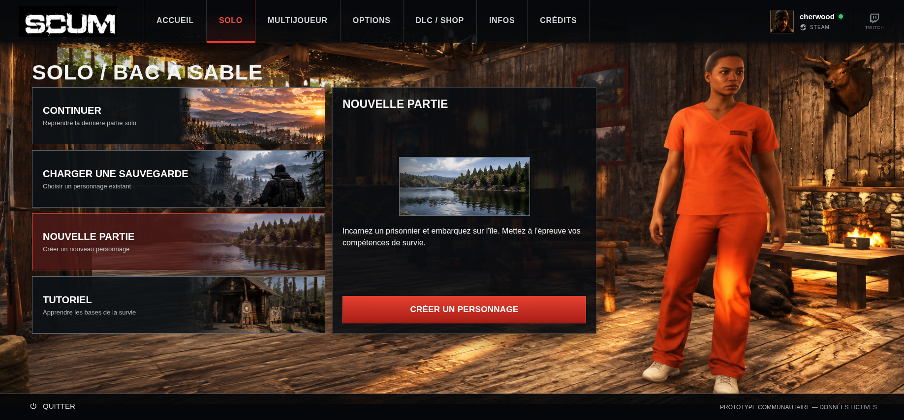

# NOUVELLE PARTIE — proposition graphique v1

Simulation uniquement, sur `review/solo-new-game-v1`, issue du dernier `main`
(`e737ead47075b9992e993533e8098a60629342cb`, fusion de la PR #10 confirmée ;
PR #9 intégrée). Aucun fichier de production ou ressource n'est modifié.
Aucune PR d'intégration, fusion, compilation ou modification de release n'est créée.

## Captures et comparaison

| Résolution | Rendu actuel | Proposition |
| --- | --- | --- |
| 1837 × 856 | [Avant](avant-1837x856.png) | [Simulation complète](nouvelle-partie-1837x856.png) |
| 1366 × 768 | [Avant](avant-1366x768.png) | [Simulation complète](nouvelle-partie-1366x768.png) |
| 390 × 844 | [Vue initiale](avant-390x844.png) · [Après défilement](avant-detail-390x844.png) | [Vue initiale](nouvelle-partie-390x844.png) · [Panneau complet après défilement](nouvelle-partie-detail-390x844.png) |

[Message de démonstration conservé, 1837 × 856](message-demonstration-1837x856.png).



## Choix graphique et définition de l'image

La ressource propre déjà validée pour la carte Nouvelle partie est
`assets/images/solo-nouvelle-partie.png` : **264 × 118 px**, 57 705 octets.
Elle montre le lac, la forêt et les reliefs sans textes ni interface incrustés.
Le dépôt ne contient pas de version indépendante de cette même scène en haute
définition. La proposition SOLO complète contient déjà cette scène à petite
définition ; une autre découpe n'en restituerait pas les détails absents.

L'ancienne image `solo-background.jpg` mesure 1100 × 780 px, mais contient une
interface complète. Sa définition supérieure ne la rend pas adaptée à ce panneau.

Pour afficher le lac sur les 493 px disponibles hors bordure de l'ancienne zone
illustrée sur grand écran, il faudrait un agrandissement d'environ **×1,87**.
La proposition adopte donc une **illustration centrée à sa taille native,
264 × 118 px aux trois résolutions**, avec un fin contour gris et sans recadrage.
Elle n'est ni étirée, ni répétée, ni agrandie ou reconstruite artificiellement.
Ce format assume une image d'ambiance compacte plutôt qu'une grande bannière.

La netteté reste celle du petit PNG source. Si une illustration plus large est
souhaitée lors de la revue, une véritable source propre en meilleure définition
du lac/forêt devra être fournie. Aucun nouvel asset définitif n'est inventé,
généré ou dupliqué dans cette simulation.

## Composition proposée

- Titre **NOUVELLE PARTIE** conservé en haut du panneau.
- Image lac/forêt centrée dans le bloc de contenu, à sa définition native.
- Description actuelle conservée : « Incarnez un prisonnier et embarquez sur
  l'île. Mettez à l'épreuve vos compétences de survie. » Interligne de 1,5 pour
  une lecture aérée, sans changement de famille de police ou de couleur du texte.
- Bouton **CRÉER UN PERSONNAGE** sur toute la largeur intérieure, ancré au bas
  du panneau comme Continuer et Sauvegardes. La grille répartit l'espace libre ;
  aucun positionnement absolu du contenu n'est utilisé.
- Panneau sombre et transparent, décor du chalet et accent rouge du bouton
  conservés. Aucun formulaire, champ de personnage, portrait, sauvegarde ou
  étape supplémentaire n'est ajouté.

| Élément | Avant | Proposition |
| --- | --- | --- |
| Illustration | Ancienne interface recadrée en 495 × 175 px sur grand écran, textes et personnage incrustés | Paysage propre en 264 × 118 px, centré, sans agrandissement |
| Description | Texte actuel sous l'ancienne image | Même texte, sous l'image propre, interligne plus lisible |
| Bouton sur grand écran | ≈ 272,1 px de large | 495 px de large, comme Continuer/Sauvegardes |
| Organisation | Image en haut, espace libre avant l'action | Bloc image/description centré entre titre et action |
| Action | Message de création non reproduite | Même bouton, même gestionnaire et même fenêtre |

## Géométrie et défilements

| Résolution | Panneau extérieur inchangé | Bouton | Défilement |
| --- | --- | --- | --- |
| 1837 × 856 | x = 675, y ≈ 178,1 ; 537 × 501,6 px | 495 × 56 px, visible en bas | Aucun débordement ou défilement interne |
| 1366 × 768 | x ≈ 592,5, y ≈ 174,5 ; 477,7 × 450 px | ≈ 443,7 × 56 px, visible en bas | Aucun débordement ou défilement interne |
| 390 × 844 | x = 12, y = 652 ; 366 × 480 px | 332 × 56 px | Défilement de la page nécessaire sous les quatre cartes ; aucun défilement interne |

La capture mobile de détail est prise à `scrollY = 368 px` et montre le bouton
entièrement au-dessus du footer fixe. La vue initiale est également fournie afin
de ne pas masquer le fait que le panneau commence sous les quatre cartes.
Le titre principal, le chalet, le personnage, le header, le footer et les
quatre cartes conservent leurs dimensions et leur position.

## Interaction et vérifications

Le bouton conserve son événement de production. Il ouvre exactement la même
fenêtre **MODE DÉMONSTRATION** avec « Création de personnage — écran du jeu non
reproduit », puis **FERMER**. Le HTML de la fenêtre a été comparé avant et après
habillage : il est identique. Aucun composant de dialogue n'est modifié.

[verification.json](verification.json) consigne les mesures et résultats :

- Trois résolutions vérifiées ; neuf captures, avant/après et fenêtre inclus.
- Géométrie extérieure identique avant et après injection.
- **Aucun pixel modifié hors du panneau droit**, dans les trois vues initiales.
- Textes du titre, de la description et du bouton identiques à la production.
- Image affichée en 264 × 118 px, ancienne illustration absente de ce panneau.
- Bouton de même largeur que Continuer, entièrement contenu dans le cadre ;
  aucun débordement horizontal ou défilement interne.
- Vue mobile après défilement : bouton au-dessus du footer fixe.
- Continuer, Sauvegardes et Tutoriel identiques octet pour octet en capture,
  comparés avant et après chargement des fichiers de revue.
- Vrais clics sur l'action et la fermeture ; aucune erreur JavaScript.

Les fichiers de revue ne sont jamais importés par le prototype. Le script
[capture.mjs](capture.mjs) injecte uniquement [simulation.css](simulation.css)
et [simulation.js](simulation.js) dans le navigateur, puis réapplique l'habillage
après les rendus existants. Le bouton d'origine conserve son gestionnaire.
La hauteur du panneau est mesurée avant habillage et
conservée ; cette méthode de revue ne constitue pas une intégration de production.

Avec Vite déjà lancé :

```sh
node docs/reviews/solo-new-game-v1/capture.mjs
```

Aucune compilation ni nouvelle vérification d'export autonome n'est revendiquée
pour cette simulation : les sources de production et l'export restent inchangés.
Attente de validation visuelle avant toute intégration définitive.
