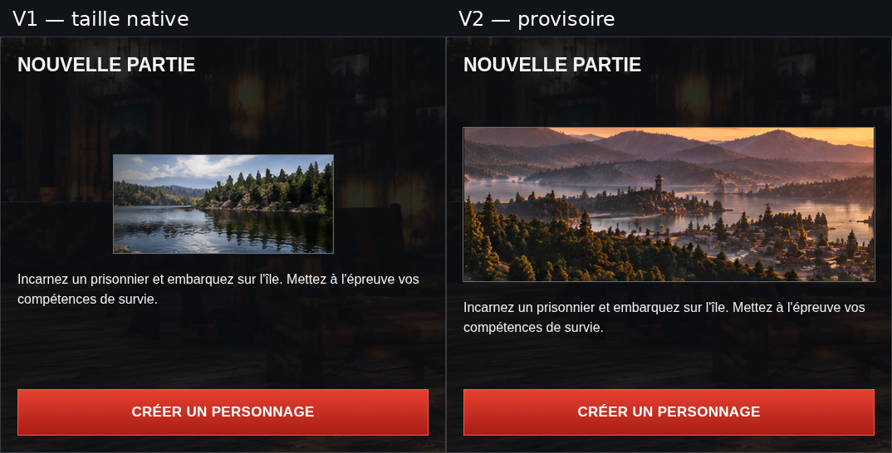

# NOUVELLE PARTIE — simulation graphique v2

**Revue uniquement**, sur `review/solo-new-game-v2`, depuis le dernier `main`
(`e737ead`, PR #9 et #10 intégrées). Aucun fichier de production, ressource dans
`assets/`, composant partagé ou export de release n'est modifié. Aucune PR
d'intégration ou fusion n'est créée.

## Captures et comparaison

| Résolution | Nouvelle proposition | Rendu actuel de production |
| --- | --- | --- |
| 1837 × 856 | [SOLO complet, panneau Nouvelle partie](nouvelle-partie-1837x856.png) | [Avant](avant-1837x856.png) |
| 1366 × 768 | [SOLO complet, panneau Nouvelle partie](nouvelle-partie-1366x768.png) | [Avant](avant-1366x768.png) |
| 390 × 844 | [Vue initiale](nouvelle-partie-390x844.png) · [Panneau après défilement](nouvelle-partie-detail-390x844.png) | [Vue initiale](avant-390x844.png) · [Après défilement](avant-detail-390x844.png) |

- [Comparaison v1/v2 complète](comparaison-v1-v2-1837x856.png) : deux captures
  **1837 × 856**, côte à côte et sans redimensionnement, avec cartouches de revue.
- [Comparaison rapprochée des deux panneaux](comparaison-panneaux-v1-v2.png) :
  découpes des captures à leur échelle réelle.
- [Fenêtre de démonstration conservée](message-demonstration-1837x856.png).



## Ressource proposée — PROVISOIRE, À VALIDER

La nouvelle bannière est [illustration-provisoire-vallee.png](illustration-provisoire-vallee.png).
Elle est stockée **uniquement dans ce dossier de revue**. Elle n'est pas un
asset de production et ne remplace pas la petite illustration de la carte gauche.

| Information | Valeur vérifiée |
| --- | --- |
| Source existante dans le dépôt | `assets/images/home-communication-officielle.png` |
| Résolution réelle de la source | **2129 × 405 px** |
| Traitement | Découpe rectangulaire de pixels : x = 730 à 1370 exclus, y = 164 à 404 exclus |
| Résolution réelle de la découpe | **640 × 240 px** |
| Contenu ajouté, génération ou interpolation enregistrée | Aucun |
| Correction colorimétrique ou retouche | Aucune |
| Image de la v1 réagrandie | Non : il s'agit d'une autre scène issue d'un autre asset existant |
| Référence de provenance | [illustration-provisoire.json](illustration-provisoire.json), coordonnées et SHA-256 |

Le panorama source est une illustration propre, sans texte, logo, bouton ou
interface incrustés. Il montre une vallée lacustre, des forêts, des reliefs et
de la brume. Le recadrage écarte la grande tour du bord gauche et le disque
solaire du panorama. Une petite tour et des constructions lointaines restent
présentes dans la scène ; aucun personnage n'est ajouté ou visible dans ce
recadrage.

L'ambiance est **brumeuse et crépusculaire, avec des tons chauds**. Elle ne doit
pas être présentée comme une image strictement froide. Son adéquation artistique
à Nouvelle partie reste soumise à votre validation, indépendamment de sa
définition suffisante pour l'affichage demandé.

La découpe de 640 × 240 n'est pas annoncée comme une nouvelle source Full HD :
ce sont les dimensions réelles de pixels disponibles pour ce cadrage. À la
résolution de contrôle 1837 × 856, elle est **réduite** en 495 × 185,625 px,
sans agrandissement. La présence visuelle passe d'environ 31 152 à 91 884 pixels
affichés, soit **près de trois fois la surface de la v1**.

### Recherche dans les ressources du dépôt

| Ressource | Résolution | Diagnostic pour cette v2 |
| --- | --- | --- |
| `solo-nouvelle-partie.png` | 264 × 118 | Lac propre de la v1, trop petit pour la nouvelle bannière ; aucun agrandissement utilisé. |
| `home-communication-officielle.png` | 2129 × 405 | Panorama propre, sans interface ; retenu pour son cadrage lac/forêt/brume réductible à la taille d'affichage. |
| `home-battleground.png` | 694 × 320 | Source propre, mais scène dominée par les survivants et la tour ; moins adaptée à l'accent paysager de ce panneau. |
| `solo-derniere-session.png` | 444 × 159 | Panorama propre mais largeur inférieure à celle de la bannière desktop, sujet centré sur la tour. |
| `last-session.jpg` | 342 × 193 | Paysage propre de petite définition, également centré sur une tour ; largeur insuffisante pour une bannière sans agrandissement. |
| `solo-background.jpg`, autres anciennes captures et maquettes de lobby avec navigation/panneaux | Dimensions diverses | Interfaces composées et éléments incrustés ; non utilisées comme illustrations du panneau. |
| `Lobby_Accueil_Illustrations_Proposition_v1.png` | 2129 × 738 | Planche d'illustrations indépendantes ; son panorama propre est déjà disponible dans l'asset `home-communication-officielle.png` retenu. |
| `Lobby_Solo_Illustrations_Proposition_v1.png` | 1836 × 856 | Maquette d'interface ; le lac n'y existe qu'en petit format, sans gain de définition exploitable. |
| Visuels Boutique | Dimensions diverses | Logos, textes promotionnels, personnages ou captures de boutique ; non retenus. |

Le dépôt ne fournit pas une version autonome plus définie du **même lac que la
v1**. Si ce paysage précis, une ambiance strictement froide ou une scène sans
aucune construction sont requis, il faudra fournir une nouvelle source propre :
par exemple une capture de paysage SCUM sans HUD, sans personnage au premier
plan, sans menu ni logo, idéalement au moins **1000 × 400 px**. Une autre
illustration fournie ou sélectionnée avec une origine documentée pourrait aussi
être proposée. Elle demanderait sa propre validation ; aucune source HD absente
n'est inventée ici.

## Composition et géométrie conservées

La v2 conserve le titre en haut, le bloc central image/description et le bouton
pleine largeur en bas de la v1. L'illustration utilise toute la largeur intérieure
avec son ratio 640:240 ; sa hauteur découle de ce ratio. Le texte descriptif est
inchangé. Les bordures, l'interligne et les couleurs restent ceux de la v1.

| Résolution | Cadre extérieur identique à la production | Illustration affichée | Bouton |
| --- | --- | --- | --- |
| 1837 × 856 | x = 675, y ≈ 178,1 ; 537 × 501,6 px | **495 × 185,625 px** | 495 × 56 px, visible en bas |
| 1366 × 768 | x ≈ 592,5, y ≈ 174,5 ; 477,7 × 450 px | **≈ 443,7 × 166,4 px** | ≈ 443,7 × 56 px, visible en bas |
| 390 × 844 | x = 12, y = 652 ; 366 × 480 px | **332 × 124,5 px** | 332 × 56 px, visible après défilement de page |

Aucun débordement horizontal ou défilement interne n'est nécessaire aux trois
résolutions. Sur mobile, le panneau reste sous les quatre cartes ; le défilement
de la page est nécessaire. La capture de détail est prise à `scrollY = 368 px`
et montre le bouton au-dessus du footer fixe. Le bouton est ancré au panneau,
pas à la fenêtre : il reste sous la ligne de flottaison dans la vue mobile initiale.

## Vérifications et périmètre

[verification.json](verification.json) consigne les contrôles navigateur :

- Dimensions et positions extérieures identiques avant et après habillage.
- **Zéro pixel modifié hors du panneau droit**, dans les trois vues comparées.
- Ratio de l'image conservé et dimensions affichées inférieures à 640 × 240 :
  aucun étirement ni agrandissement de la source.
- Inspection visuelle aux trois tailles : paysage lisible, sans fragment de
  texte/interface ; description et bouton lisibles.
- Aucun défilement interne ou débordement horizontal ; bouton entièrement contenu
  dans le cadre, au-dessus du footer dans la vue mobile après défilement.
- Textes du titre, du descriptif et du bouton identiques à la production.
- Le bouton ouvre le même message « Création de personnage — écran du jeu non
  reproduit » ; le HTML du dialogue est identique à celui de production.
- Continuer, Sauvegardes et Tutoriel identiques octet pour octet en capture
  avant et après chargement des fichiers de revue.
- Aucun formulaire ni logique de création, sauvegarde ou persistance ajouté.
  Aucune erreur JavaScript détectée.

Le script [capture.mjs](capture.mjs) injecte [simulation.css](simulation.css)
et [simulation.js](simulation.js) uniquement dans le navigateur. La hauteur du
cadre est mesurée avant habillage pour préserver la géométrie responsive de la
production. Les boutons et leurs événements ne sont pas remplacés. Les fichiers
de revue ne sont jamais importés par l'application normale.

Avec Vite déjà lancé :

```sh
node docs/reviews/solo-new-game-v2/capture.mjs
```

Les comparaisons sont des montages de captures, sans modification de leurs
pixels, et ne servent jamais de fond d'interface. La capture v1 est archivée depuis
`review/solo-new-game-v1` (commit `f379686`).

Aucune nouvelle compilation ou vérification d'export de production n'est
revendiquée pour cette simulation, les sources de l'application restant intactes.
Attente de validation visuelle de la v2 **et de la ressource provisoire** avant
toute intégration définitive.
