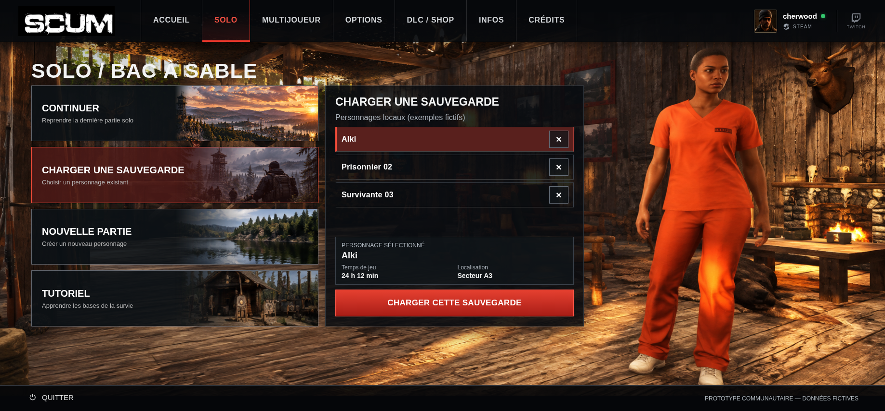

# SOLO — intégration de la composition Sauvegardes v1

Branche `feat/solo-saves-composition`, issue du dernier `main` (`5dd6192`, PR #9
fusionnée). Référence graphique : `review/solo-saves-composition-v1`, commit
`de02154c7f6cd3cb755b4600cf2f2456a42b041c`.

## Captures définitives et comparaison à la simulation

| Résolution | Alki | Prisonnier 02 |
| --- | --- | --- |
| 1837 × 856 | [Intégration](development-alki-1837x856.png) · [Simulation](approved-alki-1837x856.png) | [Intégration](development-prisonnier-02-1837x856.png) · [Simulation](approved-prisonnier-02-1837x856.png) |
| 1366 × 768 | [Intégration](development-alki-1366x768.png) · [Simulation](approved-alki-1366x768.png) | [Intégration](development-prisonnier-02-1366x768.png) · [Simulation](approved-prisonnier-02-1366x768.png) |
| 390 × 844 | [Vue initiale](development-alki-390x844.png) · [Panneau après défilement](development-alki-detail-390x844.png) | [Vue initiale](development-prisonnier-02-390x844.png) · [Panneau après défilement](development-prisonnier-02-detail-390x844.png) |

Les mêmes captures de l'export hors ligne sont enregistrées sous `offline-*`.
Les huit cadrages d'intégration Vite et hors ligne sont **identiques octet pour
octet** aux PNG approuvés, y compris les deux vues mobiles après défilement.
Les empreintes figurent dans [verification.json](verification.json).



## Modifications

- `src/pages/solo.js` : seul le contenu du parcours `load` est recomposé.
  Trois lignes compactes, sélection rouge avec liseré, résumé du personnage
  et bouton plein format. Les mêmes noms, indices et gestionnaires de clic
  sont conservés. La grande illustration est retirée de ce panneau.
- `src/styles/pages/solo-saves.css` : grille du panneau, liste défilable si
  nécessaire, résumé et bouton en bas. Aucun positionnement absolu du contenu.
  Les règles ne concernent que Sauvegardes et ses nouvelles classes.
- `src/main.js` : import de la feuille CSS.
- `tests/solo-saves.spec.js` : vérifications des captures, dimensions, absence
  de défilement, données, sélections, chargement et confirmations, en
  développement et hors ligne aux trois résolutions.
- Les tests historiques sont adaptés uniquement pour remplacer les attentes
  sur l'ancien contenu intérieur Sauvegardes par les références approuvées.
  Les autres textes, boutons, géométries et parcours restent contrôlés.

Le résumé reprend **24 h 12 min / Secteur A3** pour Alki et **Non renseigné** pour
les deux champs des autres personnages. Aucun portrait ou donnée supplémentaire
n'est créé.

## Dimensions et défilement

| Résolution | Cadre conservé | Largeur du bouton | Défilement nécessaire |
| --- | --- | --- | --- |
| 1837 × 856 | x = 675, y ≈ 178,1 ; 537 × 501,6 px | 495 px, comme Continuer | Aucun : trois personnages, résumé et bouton visibles. |
| 1366 × 768 | x ≈ 592,5, y ≈ 174,5 ; 477,7 × 450 px | ≈ 443,7 px, comme Continuer | Aucun dans le panneau ou la liste. |
| 390 × 844 | x = 12, y = 652 ; 366 × 613 px | 332 px, comme Continuer | Défilement de la page sous les cartes ; aucun défilement interne avec trois personnages. |

La hauteur extérieure mobile approuvée, **613 px**, est déclarée dans la règle
responsive du seul panneau Sauvegardes. La production n'utilise aucune mesure
DOM, injection ou observateur issu de la simulation. La grille laisse la liste
se réduire et défiler si le contenu demande davantage de place ; le titre,
le résumé et le bouton restent hors de la zone défilable.

## Périmètre conservé

- Continuer, Nouvelle partie et Tutoriel conservent leurs templates, ressources,
  textes et gestionnaires. Les cartes de gauche et les cadres restent ceux de
  la PR #9 ; les tests existants conservent leurs contrôles sur ces parcours.
- Le chalet, le personnage, le header, le footer, la navigation et les autres
  rubriques sont inchangés. Aucune ressource graphique n'est ajoutée ou modifiée.
- `solo-background.jpg` reste disponible pour les autres parcours qui l'utilisent ;
  il n'est plus affiché dans le panneau Sauvegardes.
- `src/components/dialogs.js`, `src/state.js`, la persistance et la navigation
  ne sont pas modifiés. La suppression reste simulée et conserve les trois
  lignes ; le chargement ne met pas à jour Dernière session, qui reste Alki.
- Aucun fichier de la release v0.5.0 n'est modifié. Aucun tag ou release n'est créé.

## Vérifications reproductibles

Résultats : **43 tests réussis, aucun échec ni test ignoré**. Exécution en deux
groupes complémentaires :

```sh
PLAYWRIGHT_CHROMIUM_EXECUTABLE_PATH=/usr/bin/chromium \
  SCUM_SAVES_CAPTURE_DIR=docs/reviews/solo-saves-integration \
  npx playwright test tests/solo-saves.spec.js
# 3 réussis : Sauvegardes aux trois résolutions, en développement et hors ligne.

PLAYWRIGHT_CHROMIUM_EXECUTABLE_PATH=/usr/bin/chromium \
  npm test -- --grep-invert 'SOLO Sauvegardes'
# Compilation puis 40 réussis : tous les autres tests de la suite.

npm run format:check
# Réussi.
```

L'export `dist/index.html` est le seul fichier généré : **16 924 289 octets**,
avec ses 30 images uniques, son CSS et son JavaScript embarqués. Aucun script
ou fichier CSS externe n'est requis. Les contextes hors ligne des tests ne
déclenchent aucune requête réseau nécessaire. L'intégrité des ressources
historiques est conservée ; les autres rubriques restent vérifiées face à la
V0.4.3, avec leurs références spécifiques pour l'Accueil et SOLO.

Les références `approved-*` sont copiées depuis la branche approuvée, sans
modification. Le manifeste [approved-verification.json](approved-verification.json)
conserve les mesures et observations de cette revue.

Les trois tests dédiés Sauvegardes comparent les pixels aux huit captures de
référence, mesurent les cadres et le bouton, vérifient l'absence de défilement,
les trois sélections et leurs données, le chargement, l'annulation et la
suppression simulée d'une ligne non sélectionnée. Ils confirment le maintien des
trois lignes, de la sélection et de Dernière session. Au retour à Continuer,
la capture égale celle prise avant d'ouvrir Sauvegardes. L'export est chargé
dans un contexte hors ligne sans requête réseau nécessaire ni erreur JavaScript.

Les tests historiques de géométrie/palette ne comparent plus l'illustration
retirée à la V0.4.3. Le contrôle d'illustrations conserve les cadres extérieurs
de Sauvegardes et toutes les mesures/textes des trois autres parcours. Le test
de parité compare les noms, le personnage choisi, les boutons et les dialogues
sans exiger les anciens textes de mise en page : le nouveau résumé est contrôlé
par les tests de captures dédiés.

Pour exécuter la compilation et tous les tests :

```sh
PLAYWRIGHT_CHROMIUM_EXECUTABLE_PATH=/usr/bin/chromium npm test
npm run format:check
```

Pour réenregistrer les captures d'intégration après compilation :

```sh
SCUM_SAVES_CAPTURE_DIR=docs/reviews/solo-saves-integration \
  PLAYWRIGHT_CHROMIUM_EXECUTABLE_PATH=/usr/bin/chromium \
  npx playwright test tests/solo-saves.spec.js
```

Les références approuvées ne sont jamais régénérées par ces commandes.
`dist/index.html` reste l'export autonome généré et non versionné, avec les
images, le CSS et le JavaScript embarqués.

Cette intégration attend la validation visuelle finale avant fusion.
